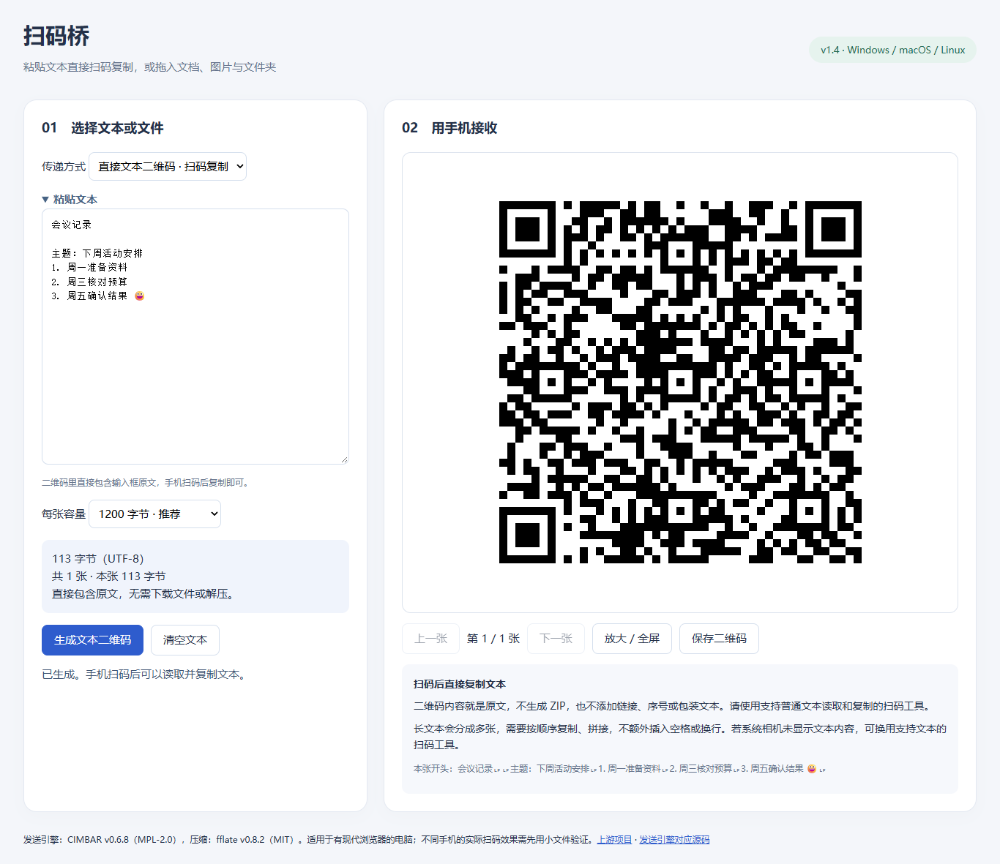
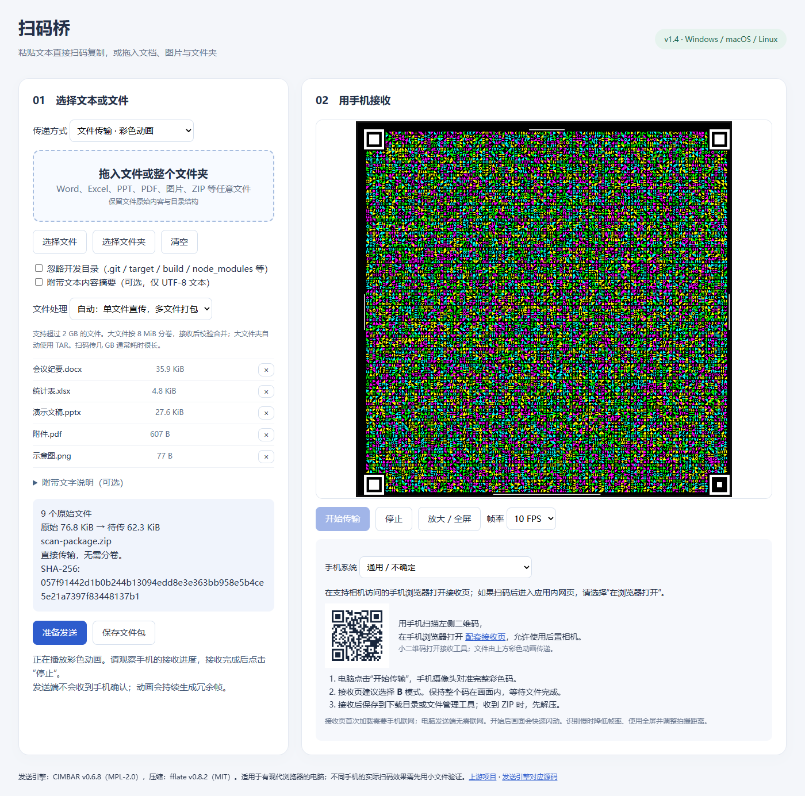

# 扫码桥 · Scan Bridge

把电脑上的文字和文件，通过屏幕传到手机。可以粘贴普通文本直接扫码复制，也可以拖入 Word、Excel、PPT、PDF、图片、压缩包或整个文件夹。适合办公、学习和开发等需要取出文本或文件的场景。

An offline, single-file browser tool for transferring text and arbitrary files from a desktop screen to a phone. Paste text for plain QR codes, or drop documents, images and folders for CIMBAR optical transfer.





## 下载与运行

从 [Releases](https://github.com/1CWwW/scan-bridge/releases) 下载 **`scan-bridge.html`**，双击并用现代浏览器打开，无需安装 Python、Node.js 或其他运行环境。也可以克隆仓库后打开 `dist/scan-bridge.html`。

电脑发送端的依赖全部嵌入 HTML，运行时没有 HTTP/HTTPS 请求。手机接收网页首次加载需要联网；Android 还可选用上游接收应用。内容通过屏幕与相机传递，电脑不需要与手机处于同一网络。

## 支持哪些内容

| 内容 | 用法 | 手机收到什么 |
| --- | --- | --- |
| 普通文字、会议记录、网址、代码 | 粘贴文本，生成黑白二维码 | 扫码读取并复制原文 |
| 单个 Word / Excel / PPT / PDF / 图片等文件 | 拖入文件，点击“准备发送” | 原文件，保留原格式和原字节 |
| 多个文件、文件夹 | 拖入后准备发送 | ZIP / 大批量 TAR，解压恢复目录与原文件 |
| 长文本、文件加说明 | 文件模式中粘贴文字说明 | ZIP 内的 `pasted-text.txt` 和所选文件 |

不限制扩展名：DOC / DOCX、XLS / XLSX、PPT / PPTX、WPS 文件、PDF、TXT、图片、音视频及其他二进制文件都按原字节处理。不依赖 Office，不转换文档格式。手机查看、编辑或播放文件，需要对应软件。

默认**单文件保持原格式，多文件自动打包**。小批量生成 ZIP，原始内容超过 64 MiB 自动改为流式 TAR；也可手动选 TAR。现有 ZIP 按普通原文件处理。摘要和开发目录过滤默认关闭，普通文件夹中的 `build`、`target` 不会自动排除。

## 电脑与手机

| 设备 | 使用方式 | 说明 |
| --- | --- | --- |
| Windows、macOS、Linux 电脑 | Chrome / Chromium / Edge / Firefox 等现代浏览器打开本地 HTML | 文件模式需要图形加速；文件夹拖入受浏览器支持影响，可改用“选择文件夹” |
| iPhone / iPad | Safari 打开 [网页接收端](https://cimbar.org/recv.html) | 允许相机，接收页选择 B 模式 |
| Android（小米、OPPO、vivo、三星等） | 支持相机的浏览器打开接收页，或使用 [CFC 接收应用](https://github.com/sz3/cfc/releases) | CFC 上游当前正式支持 arm64-v8a，适用范围以其说明为准 |
| HarmonyOS、其他手机系统 | 支持相机与相关网页能力的系统浏览器打开接收页 | 先用小文件验证，不假设这些系统都能安装 Android 应用 |

文本模式使用支持**纯文本读取和复制**的扫码工具。部分系统相机只处理网址而不显示完整文本，需换用文本扫码工具。手机品牌不参与编码；实际接收能力取决于浏览器、相机和接收工具。

## 快速使用

**传文字**：粘贴文字 → “生成文本二维码” → 手机扫码复制。每张可选 600 / 1200 / 2200 个 UTF-8 字节，超出容量会分成多张，按顺序复制拼接。二维码只含原文片段。长文本需要自动恢复时使用文件模式。

**传文件**：切换文件模式 → 拖入或选择文件 → “准备发送” → 手机扫描小二维码打开接收页并允许相机 → 电脑“开始传输” → 手机对准完整彩色动画 → 接收完成后保存原文件或解压 ZIP。

**已取消 20 MiB / 25 MiB 文件总量限制，支持超过 2 GiB 的文件。** 待传内容超过 16 MiB 后自动切为 8 MiB 分卷；每卷独立接收并保存为 `.sbpart`，最后校验合并。逐段读取，容量取决于浏览器、磁盘及接收设备，每批仍最多 5000 个原文件。

[大文件与还原说明](docs/large-files.md)：支持卷号跳转、重扫和重新选择同一文件后继续原卷号。大于 2 GiB 的最终合并推荐电脑 Chrome/Edge 流式写盘或 Python 工具；不支持写盘的浏览器只提供 128 MiB 以内存合并。手机可分卷保存，但不保证能在手机浏览器合并几 GB 的文件。

扫码吞吐量仍受光学链路限制：**即使实际达到 100 KiB/s，2 GiB 的纯数据也要约 5.8 小时**，还未计冗余和操作时间。取消容量限制并不提高传输速度。完成状态以手机为准，电脑没有接收反馈通道。

详细操作见 [使用说明](docs/usage.zh-CN.md)，平台验证范围见 [兼容性说明](docs/compatibility.md)。

## 开发与测试

Python 3.10+ 使用标准库离线构建，并校验本地依赖 SHA-256：

```sh
python3 source/build.py
```

输出 `dist/scan-bridge.html`、兼容早期入口的 `dist/code-bridge.html` 和可检查的 `dist/cimbar-engine.html`。还会生成离线分卷还原页面 `dist/merge-parts.html` 和标准库合并脚本 `dist/merge-parts.py`。构建结果可重复生成。

测试需要 Node.js 22+ 和 Python 3.10+，首次安装测试依赖需联网：

```sh
npm ci
npx playwright install chromium
python3 -m pip install -r tests/requirements.txt
python3 source/build.py
python3 tests/create_documents.py
npm test
python3 tests/verify_plain_decode.py
python3 tests/verify_code_zip.py
python3 tests/verify_documents.py
python3 tests/verify_large_files.py
```

Linux CI 使用 `npx playwright install --with-deps chromium`。可设置 `CHROME_PATH` 指向现有 Chrome / Chromium。测试产物写入忽略目录 `test-results/`，办公文档和其他样例全部是合成内容。

工作流在 Windows、Ubuntu、macOS 上检查构建和 Chromium 集成测试。覆盖真实磁盘拖入、独立 QR 解码、Office 与二进制文件原字节校验、单文件直传、多文件 ZIP、目录和空文件、可选摘要、编辑失效、动画启停及发送端离线运行。大文件测试实际完整读取一个超过 2 GiB 的文件并验证首末卷，单次读取最多 8 MiB；35 MiB 样例完成浏览器及独立 Python 合并，并独立检查 TAR 路径与校验值。**真实手机摄像头链路仍需各设备实测**，自动测试不等同于认证所有品牌手机。

## 许可证与上游

自有界面、构建工具和测试采用 [MIT](LICENSE)。**CIMBAR 及其修改部分采用 MPL-2.0**；其他库及底层依赖保留各自许可证。发行文件嵌入完整授权声明。

来源、版本和对应源码见 [THIRD_PARTY_NOTICES.md](THIRD_PARTY_NOTICES.md)。感谢 [CIMBAR](https://github.com/sz3/libcimbar)、[CFC](https://github.com/sz3/cfc)、[fflate](https://github.com/101arrowz/fflate)、[js-sha256](https://github.com/emn178/js-sha256) 和 [Project Nayuki](https://www.nayuki.io/page/qr-code-generator-library)。
